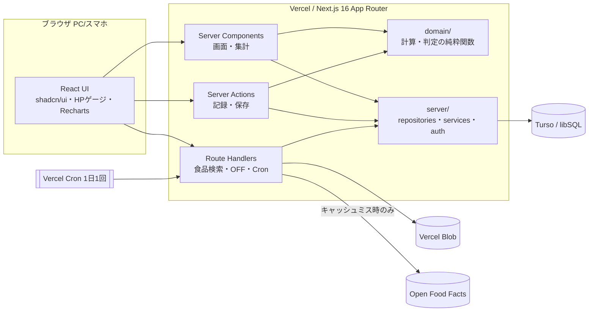

# dietlog — 自炊も外食も記録できる食事記録

自炊は「食材の重さ × 調理法」から、外食・市販品は商品検索や手入力で記録し、1日の目標に対する栄養素を RPG の HP バーのようなゲージで確認できる Web アプリです。1週間分の記録から、日本人の食事摂取基準(2025年版)と比べた栄養バランスを表示します。

> 個人が就職活動用のポートフォリオとして制作した非公式プロジェクトです。特定の企業とは関係ありません。表示される分析は参考情報であり、医療に代わるものではありません。

- **デモ**: [dietlog-nine.vercel.app](https://dietlog-nine.vercel.app) — 「登録せずに試す」を押すと、6日分のサンプル記録が入った状態ですぐに使えます
- 設計書: [docs/architecture.md](docs/architecture.md) / 実装時の判断: [docs/adr/](docs/adr/)

## 主な機能

| 機能 | 内容 |
|---|---|
| 自炊の記録 | 食材(日本食品標準成分表)・重量・調理法(生/ゆで/蒸し/焼き/炒め/揚げ…)・油・調味料から計算。成分表に調理後データがある食材はそれを優先し、ない食材は重量変化率と吸油量で補正。計算の内訳を表示 |
| タグ(テンプレート) | よく作る料理を保存し、ワンタップ・人前の調整で記録 |
| 市販品・外食 | Open Food Facts のキーワード検索、成分表の料理・惣菜(目安値)、パッケージ表示の手入力、写真の添付(参照用) |
| 自分の商品リスト | 検索・手入力した商品を保存し、次回から優先して呼び出し |
| HP ゲージ | カロリー・PFC・食塩・食物繊維など。目標超過は赤で表示、データのない食品を含む場合は斜線で表示 |
| 履歴 | 日別(14日)・週別(8週)のグラフと表 |
| 栄養バランス | 直近7日の平均を食事摂取基準と比較。記録日が5日未満なら保留、データが欠けている栄養素は「判定不可」として区別。直近4週の傾向も表示 |
| お試しモード | 登録なしで開始。訪問者ごとに独立したデータ、14日後に自動削除。GitHub で本登録すると記録を引き継ぎ |

## アーキテクチャ



| 領域 | 採用 |
|---|---|
| フレームワーク | Next.js 16(App Router)+ TypeScript |
| DB | Turso(libSQL)+ Drizzle ORM |
| 認証 | Better Auth(anonymous プラグインでお試しモード、GitHub OAuth で本登録) |
| UI | Tailwind CSS v4 + shadcn/ui、グラフは Recharts、HP ゲージは自作 |
| テスト | Vitest(ユニット・DB 結合)、Playwright(E2E、PC とスマホの表示サイズ) |
| デプロイ | Vercel(Cron でお試しデータを削除)、画像は Vercel Blob |

```
src/
├─ app/            画面・Server Actions・Route Handlers
├─ domain/         ★計算・判定の純粋関数(フレームワーク非依存・ユニットテスト対象)
│  ├─ calc/        自炊・市販品の栄養計算
│  ├─ analysis/    栄養バランスの判定
│  ├─ goals/       目標の自動算出・ゲージ状態
│  ├─ dri/         食事摂取基準の参照
│  ├─ mext/        成分表の値の解釈・調理法
│  └─ copy/        分析画面の文言(禁止語テスト付き)
├─ server/         DB・外部 API・認証(server-only)
└─ components/     UI
data/              参照データ(出典は data/README.md)
scripts/           データの取り込み・DB 投入
tests/             結合テスト・E2E
```

## カロリー計算の仕組み

成分表は「可食部 100 g あたり」の値です。調理で重さが変わるため、計算は**調理前の可食部重量 `W_raw`** を基準にします。

1. **入力の正規化** — 生の可食部ならそのまま、皮・骨込みの重さなら廃棄率を除く `W_raw = 入力 × (100 − 廃棄率) / 100`、調理後に量った重さなら重量変化率で戻す `W_raw = 入力 × 100 / 重量変化率`
2. **調理後データがある食材(優先)** — 成分表 第1章の式(c4)
   `摂取量 = 調理後の成分値 × (W_raw × 重量変化率 / 100) / 100`
   例: ほうれんそう生 100 g をゆでる → 「ゆで」23 kcal/100 g × 70 g = **16.1 kcal**(重量変化率 70%、表12)
   油いため・揚げ物の調理後データは油の吸着を含むため、入力した油は二重に加算しません。
3. **調理後データがない食材(後備)** — 生の成分値 × `W_raw` に、吸油量 `W_raw × 吸油率 / 100` 分の油を加算。使った油が多くても吸着分(`min(使用量, 吸油量)`)だけを加算し、「全部食べた」を選ぶと全量を加算します。吸油率・重量変化率は、成分表の調理前後のデータから算出した調理法 × 食品群の中央値です。
4. **調味料** — 使用量(g)をそのまま加算。大さじ・小さじ・mL は成分表の備考にある密度(例: こいくちしょうゆ 100 mL = 118.1 g)で換算。
5. **不明値** — 成分表の「-」(未測定)は 0 ではなく「不明」として扱い、合計でも不明を区別します。

エネルギーは成分表の `ENERC_KCAL` をそのまま使います(八訂は成分ごとの換算係数で算出済みのため、4・9・4 で計算し直しません)。

## 栄養バランスの判定

- 基準: 厚生労働省「日本人の食事摂取基準(2025年版)」の成人の値(`data/dri/dri-2025.json`)。指標の種類ごとに判定を分けます
  - 推定平均必要量・推奨量がある栄養素: 平均 < 推定平均必要量 → 不足傾向、< 推奨量 → やや少なめ
  - 目安量の栄養素(ビタミンD・E・K・B12、カリウム): 下回っても「不足とは判断できない」と表示
  - 目標量(食塩・食物繊維): 目標に届かない/超えている
- 信頼性の担保
  - 直近7日のうち記録日(3食以上 or「記録完了」)が **5日未満なら保留**
  - 栄養素ごとに、値が分かっている食品が摂取エネルギーに占める割合(カバレッジ)を計算し、**80% 未満は「データ不足で判定不可」**。市販品・外食の多くはビタミン・ミネラルの記載がないため
  - 80% 以上でも、データのない分を 0 として平均すると「不足」に偏るため、エネルギー比で補った平均で判定(補正前の値も表示)
- 表現: 「食事摂取基準と比較した参考情報」にとどめ、診断・効能を連想させる語は使いません(禁止語をユニットテストで検査)

## データソースの選定理由とトレードオフ

| データ | 使い方 | 強み | 弱み・対策 |
|---|---|---|---|
| 日本食品標準成分表(八訂)増補2023年 | 食材・調味料・料理(目安値)・調理後データ | 公的で網羅的(2,538食品・54成分)、調理後の収載(ゆで197・焼き112・油いため42 など)と重量変化率(表12)がある | 食品名が日常語と違う → 同義語辞書で検索語を展開(「鶏むね」→「にわとり むね」)。料理・惣菜は18群で55品のみ → 全食品群の調理済み品も目安値として検索 |
| Open Food Facts | 市販品のキーワード検索 | 日本の商品もある程度登録され、旧検索 API なら日本語検索の精度が実用的 | **レート制限が厳しい**(実測で約4回/分でも 503)→ 全ユーザー共有の DB キャッシュ(検索7日・商品30日)、全体 8回/分の制限(公式は検索 10回/分/IP)、503 は1回だけ再試行して15秒停止、人気語の事前取得(`pnpm data:warm-off`)、手入力への誘導。ビタミン・ミネラルはほぼ記載なし → 分析では「判定不可」として区別 |
| 手入力 | パッケージ・お店の表示 | 必ず記録できる | 記載のない成分は空欄=「不明」として保存(0 にしない) |

成分表のデータ Excel(2026-03-27 版)には正誤表の訂正がすでに反映されていました。取り込み時は正誤表の「正」値 307 項目との一致を検証し、不一致なら上書きする冪等な処理にしています。

## 出典・クレジット

- 食品成分値は **日本食品標準成分表（八訂）増補2023年から引用**(文部科学省、データ更新日 2026年3月27日、正誤表 令和8年3月27日)。食品成分データベース(fooddb.mext.go.jp)からの取得は行っていません
- 市販品の商品データ: [Open Food Facts](https://world.openfoodfacts.org/)、[Open Database License (ODbL)](https://opendatacommons.org/licenses/odbl/1-0/)。OFF 由来のデータは ODbL の下で提供します。取得データは改変せず保存し、利用者の修正値は別に保存しています。商品画像は表示しません
- 基準値: 厚生労働省「日本人の食事摂取基準(2025年版)」

## ローカルで動かす

Node.js 22 以上と pnpm が必要です。

```bash
pnpm install
cp .env.example .env.local   # BETTER_AUTH_SECRET などを設定
pnpm db:migrate              # ローカルの SQLite(local.db)を作成
pnpm db:seed                 # 成分表・食事摂取基準などのマスタを投入
pnpm dev                     # http://localhost:3000
```

成分表を公式ファイルから取り込み直す場合: `pnpm data:download && pnpm data:build && pnpm db:seed`

## テスト

```bash
pnpm test        # ユニット + DB 結合テスト(計算式・判定・データ分離・削除)
pnpm e2e         # Playwright(お試し開始 → 自炊を記録 → ゲージ → 分析、PC とスマホ)
pnpm lint && pnpm typecheck
```

## デプロイ(Vercel + Turso)

1. Turso でデータベースを作成し、`DATABASE_URL`(`libsql://…`)と `DATABASE_AUTH_TOKEN` を取得
2. 本番 DB に `DATABASE_URL=… DATABASE_AUTH_TOKEN=… pnpm db:migrate && pnpm db:seed`
3. Vercel にリポジトリをインポートし、環境変数を設定(`.env.example` 参照)。`BETTER_AUTH_URL` は本番 URL
4. (任意)GitHub OAuth App を作成し、callback URL `https://<本番ドメイン>/api/auth/callback/github` を登録して `GITHUB_CLIENT_ID` / `GITHUB_CLIENT_SECRET` を設定
5. (任意)Vercel Blob を作成して `BLOB_READ_WRITE_TOKEN` を設定(商品写真の添付)
6. `vercel.json` の Cron(1日1回)でお試しデータを削除。`CRON_SECRET` を設定
7. (任意)`pnpm data:warm-off` で OFF の人気検索語をキャッシュ
