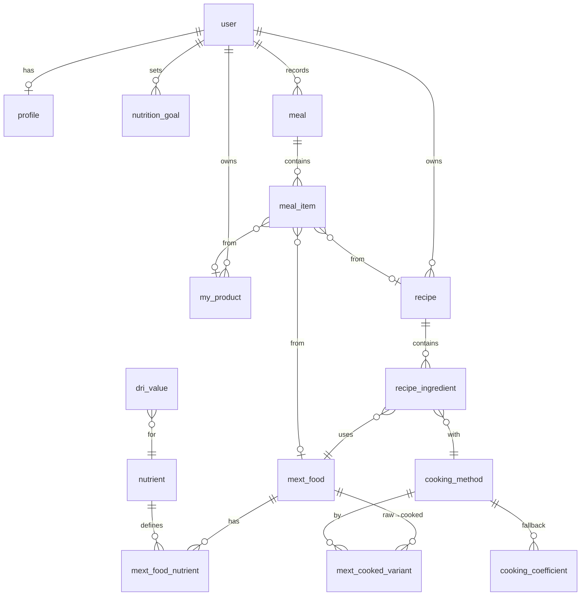
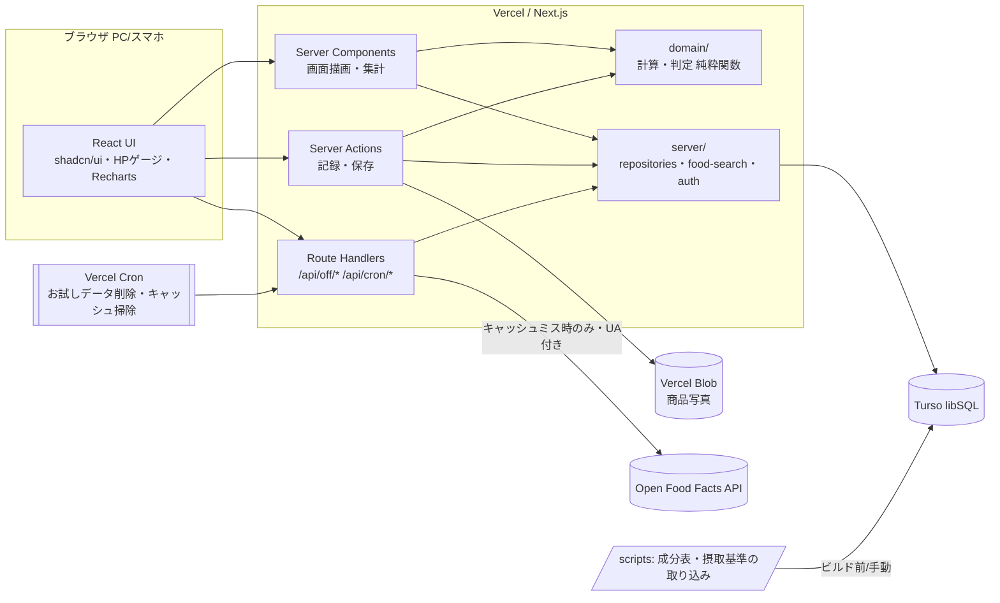
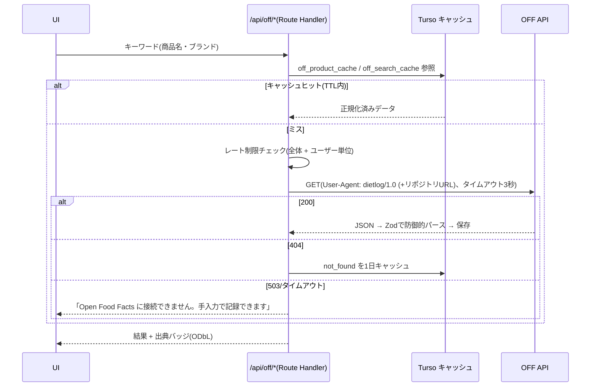
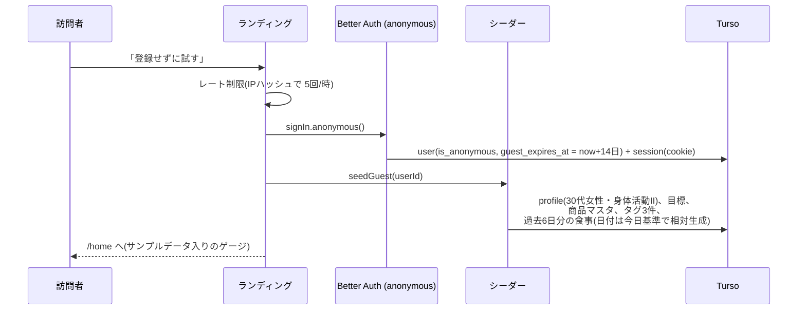

# 食事記録Webアプリ 技術選定・アーキテクチャ設計書(v0.5 ドラフト)

- 作成日: 2026-11-22(v0.2 更新: 同日)
- ステータス: レビュー待ち(コード・プロジェクトは未作成)
- アプリ名: **dietlog**(確定)

**v0.2 での変更点(要件の反映)**

- バーコードの入力・スキャン機能を削除(外食・市販品はキーワード検索・手入力・写真アップロードで対応)
- 「PC・スマホ両対応のレスポンシブWebアプリ」に統一し、PWA化・カメラ連携を範囲外とした(§3.5)
- 外食の商品写真アップロード(参照用)を MVP(M2)に前倒し
- n-3系脂肪酸分析の時期の記述ゆれ(M4/M5)を、マイルストーン表どおり M5 に統一

**v0.3 での変更点(§11.2 の確認事項への回答の反映)**

- 本登録は **GitHub OAuth のみ**(§1.1)
- 分析の根拠に **直近4週の継続性(長期傾向)** を追加(§5.3)
- プロフィールは **年齢・性別・身長・体重・身体活動レベルをすべて必須** に(§2.3・§3.3)
- お試しデータの保持期間を **14日** に(§8)
- パッケージ写真の **OCRは実施しない**(M5から削除)
- アプリ名を **dietlog** で確定

**v0.4 での変更点**

- **サプリメント提案機能を削除**(作者判断。面接で聞かれた場合に口頭で補足する)。§6 を「対象外とした機能」に置き換え、関連するテーブル・モジュール・ディレクトリ・法令リスク・マイルストーンを削除
- 栄養不足の判定(週間分析)は継続。画面の末尾は商品の提案ではなく「食事から摂る工夫」(成分表で該当栄養素が多い食品の例)とする

**v0.5 での変更点**

- 自炊の分量入力を、個数・目安単位ではなく **グラム入力(既定)** に変更(作者判断)。個数→グラム換算表(`food_unit`)は不要になったため削除。調味料の大さじ・小さじ・ml入力は、成分表の備考にある密度から換算するため従来どおり

> この設計書の **§0「一次資料の調査結果」** は、文部科学省・Open Food Facts の公開ファイル/APIを実際に取得して確認した内容です。確認していない事項(料金プランの上限値など)は「要確認」と明記しています。

---

## 目次

0. [一次資料の調査結果(先に読んでほしい要点)](#0-一次資料の調査結果)
1. [技術選定](#1-技術選定)
2. [データベース設計](#2-データベース設計)
3. [モジュールと画面構成](#3-モジュールと画面構成)
4. [カロリー計算の設計](#4-カロリー計算の設計)
5. [栄養不足判定ロジック](#5-栄養不足判定ロジック)
6. [対象外とした機能](#6-対象外とした機能)
7. [データソース連携](#7-データソース連携)
8. [お試しモード](#8-お試しモード)
9. [法令・表示上のリスクと対策](#9-法令表示上のリスクと対策)
10. [開発マイルストーン](#10-開発マイルストーン)
11. [リスクと判断が必要な事項](#11-リスクと判断が必要な事項)

---

## 0. 一次資料の調査結果

### 0.1 文部科学省 食品成分データ(2026-11-22 時点で取得・確認)

| 項目 | 確認結果 |
|---|---|
| 最新版 | 日本食品標準成分表(八訂)増補2023年。公開ページの **データExcelは「更新日：2026年3月27日」**、正誤表も **令和8年3月27日付** |
| 今後の更新予定 | 公表履歴ページ(mext_02092)に「現在、更新予定の収載値(案)等のデータはありません」と記載 |
| 本表データ | `第2章(データ)` Excel 1シート「表全体」、**2,538食品 × 成分識別子54項目 + 備考**。ヘッダー12行目に INFOODS 準拠の成分識別子(`ENERC_KCAL`, `PROT-`, `FAT-`, `CHOAVLDF-`, `NA`, `FE`, `VITA_RAE` …) |
| 正誤表 | `正誤表(データ)` Excel、9シート(本表第1章/本表第2章/本表(誤・正の行データ)/アミノ酸/脂肪酸/炭水化物 各編) |
| **正誤表の適用状況** | **2026-03-27版の本表Excelには正誤が既に反映済み** であることを抜き取りで確認(例: トマトケチャップ 17036 のエネルギー 誤104→正116 kcal、Excelは116。マヨネーズの名称「半固形状→半固体状」も反映済み)。→ 取り込み時は「正誤表を当てる」のではなく **「正誤表の“正”値とExcel値の一致を検証し、不一致なら正値で上書きして警告」** という冪等な処理にする(§7.1) |
| 値の表記 | `-`(未測定: 約18,600セル)、`(数値)`(推計値: 約21,200セル)、`Tr`/`(Tr)`(微量)、`(0)`(推定ゼロ)、`*`(エネルギー計算に用いた炭水化物の列を示す記号)、`†`(3セル) |
| 欠損の多い成分 | ヨウ素・セレン・クロム・モリブデン・ビオチンは **約1,170食品(46%)で「-」**。成分表由来の食品でも「データ不足で判定不可」が起こり得る |
| 調理後の収載 | 食品名に調理法を含む食品数(重複あり): **ゆで197、焼き112、煮101、揚げ69、水煮61、油いため42、フライ33、蒸し24、天ぷら15、電子レンジ調理8、ソテー7、素揚げ6**。「炊き」は食品名ではなく「めし」として収載 |
| 重量変化率の所在 | 電子書籍PDF 第1章 **表12「調理方法の概要および重量変化率表」**(PDF p.39〜)。調理前食品番号・調理過程・用いた水/油/塩の量・重量変化率(%)を食品ごとに記載。計算式 (c1)〜(c5) は第1章 6)(p.36〜37) |
| 吸油量の所在 | **表13「揚げ物における衣の割合及び脂質量の増減」**、**表14「炒め物における脂質量の増減」**(p.64〜68)。炒め物は「生の材料100 g + 植物油5.0 g」の条件で測定 |
| 後備用の変化率 | **第3章3「調理による成分変化率区分別一覧表」**(p.433〜)。食品群×調理法区分ごとの成分残存率の中央値。ただし **このPDFの表はフォントの都合で機械抽出できない(文字化け)** ため、必要な行は手作業で転記する |
| 調理済み流通食品 | **18群は55食品のみ**(和風料理18・洋風料理29・中国料理8・韓国料理1)。例: 肉じゃが、筑前煮、とん汁、親子丼の具、カレー3種、ハンバーグ3種、コロッケ、えびフライ、ぎょうざ、しゅうまい、麻婆豆腐、チャーハン 等。成分値は **事業者レシピから算出した計算値**(成分表自身が「レシピが異なれば成分値も異なる」と明記) |
| 18群以外の料理 | 家庭で小規模に調理する料理は原材料の属する群に収載(例: 天ぷら・フライ・から揚げ・とんかつ等は魚介/肉群、パン・めん類は1群、菓子は15群)。→ 「目安値」検索は **18群だけでなく全群の加工・調理済み品** を対象にする必要がある |
| 正誤表で見えた注意点 | 表12そのものにも正誤あり(例: 06359 ほうれんそう油いための「用いた水・油の量」)。転記データにも正誤反映が必要 |

**利用条件・出典表記(公式ページ・Q&Aで確認)**

- 成分表トップページ「食品成分データの利用及び引用について」: データは自由に利用可能。論文・書籍・**アプリケーション等の二次利用** では出典として **「日本食品標準成分表（八訂）増補2023年から引用（又は出典）」** と記載するよう求めている。
- Q&A 1-11: 書籍・アプリ等の作成に **許諾手続きは不要**。ただし出典名をユーザーに分かるように明示する等、利用者間で混乱のないよう配慮を求めている。
- Q&A 1-12: 成分表の値は標準値であり、個別商品の栄養成分表示とは異なり得る(→ 「目安値」表示の根拠として引用できる)。
- 食品成分データベース(fooddb.mext.go.jp)はスクレイピングしない(本設計では一切アクセスしない)。

### 0.2 Open Food Facts 日本データ(2026-11-22 時点で実測)

| 項目 | 実測結果 |
|---|---|
| **旧検索API `world.openfoodfacts.org/cgi/search.pl`(Webサイトの検索と同じ)** | **日本語の検索精度は良好**。商品名に検索語を含む割合: 「カップヌードル」15/15件、「サラダチキン」44/45件、「おにぎり」44/50件(総54件)、「ポテトチップス」45/50件(総136件)、「からあげクン」3/3件。日本タグ付き商品が上位に並ぶ。応答 1.1〜2.4秒 |
| 旧検索APIのレート制限 | **厳しい**。7秒間隔の連続検索で 503「Page temporarily unavailable」が5回連続、15秒間隔(約4回/分)でも6回中1回 503。ユーザーの入力ごと(インクリメンタル検索)に叩く設計は不可 → キャッシュ・デバウンス・明示的な「検索」ボタン・サーバー側の全体レート制限が必須 |
| 新検索API `search.openfoodfacts.org`(search-a-licious) | 応答は速い(0.8〜1.5秒)が、**日本語ではほぼヒットしない**(「カップヌードル」「ポテトチップス」0件、「おにぎり」は無関係な商品が上位)。**使わない** |
| 商品コード指定取得 `/api/v2/product/{code}` | 安定(既知のコードで200)。未登録は404。**本設計ではバーコード入力・スキャンを提供しないため使用しない**(参考として記録) |
| 栄養素の収録率(旧検索APIで取得した163商品) | エネルギー 84%、たんぱく質・脂質 83%、炭水化物 80%、食塩相当量 62%、食物繊維 25%、**カルシウム 11%、鉄 3%、ビタミンC 3%**、他のビタミン・ミネラルはほぼなし |
| データ品質 | 入力ミスの疑い例あり(例: ある飲料で「added-sugars 59.3 g/100g」なのに炭水化物 8.7 g)。ブランド表記揺れ(Suntory / SUNTORY / サントリー、7-Premium / セブンプレミアム) |

**評価結論**: OFFは **旧検索API(Webサイトの検索と同じ `cgi/search.pl`)を使えば日本語のキーワード検索でも実用的な精度** があり、コンビニ商品(おにぎり・サラダチキン・からあげクン等)もある程度登録されている。課題は **精度ではなくレート制限** で、キャッシュとサーバー側の流量制御で吸収する(§7.2)。ビタミン・ミネラルはほぼ取れないので、§5の「データ不足で判定不可」区別は必須。検索UXは「自分の商品マスタ → OFF(市販品)/ 成分表(料理・目安値)」の順で組む(§7.3)。

> 初版では新検索API(search-a-licious)だけを根拠に「日本語検索は使えない」と書いていたが、旧検索APIで再検証して訂正した(2026-11-22)。

ライセンス: データベースは **ODbL 1.0**、個々の内容は Database Contents License、**商品画像は CC BY-SA**。User-Agent にアプリ名・バージョン・連絡先を入れることが求められている(連絡先は個人メールではなくリポジトリURL等にする)。レート制限は公式ドキュメントで「商品取得 100回/分、検索 10回/分」程度と案内されている(**実装前に最新値を要確認**)。

---

## 1. 技術選定

### 1.1 一覧

| 領域 | 採用(案) | 評価・選定理由 | 代替案と不採用理由 |
|---|---|---|---|
| フレームワーク | **Next.js(App Router)+ TypeScript**(着手時点の最新安定版) | ◎ 希望どおり。Server Components で成分表検索・集計をサーバー側に寄せられ、Server Actions でフォーム処理を簡潔に書ける。フロント/フルスタック志望のポートフォリオとして最も説明しやすい | Remix/React Router v7(採用例が少なく面接官に伝わりにくい)、Nuxt(Vue。募集要項で指定がなければReactの方が汎用的) |
| DB | **Turso(libSQL)** | ○ 無料枠で十分、エッジに近い、ローカルは `file:` のSQLiteで同じコードが動く。成分表は約2,500行×54成分=約14万値で余裕 | Neon/Supabase(Postgres。全文検索・JSON・RLSが強いが、規模に対して過剰)。※ 日本語検索をDB側でやりたくなった場合の乗り換え先として記録 |
| ORM | **Drizzle ORM + drizzle-kit** | ◎ 型安全なスキーマ・マイグレーション、libSQL対応、SQLに近く説明しやすい | Prisma(libSQL対応はあるがドライバーアダプタ周りが重い) |
| 認証 | **Better Auth**(Drizzleアダプタ + **anonymous プラグイン**) | 匿名ユーザー(お試しモード)を正式な仕組みとして持ち、後から GitHub アカウントに紐づけて本登録に「昇格」できる。Next.js App Router 対応。DBは自前(Turso)なので外部SaaSにユーザーデータを置かない | Auth.js v5(匿名ログインは自作が必要)、Clerk(導入は最速だが外部SaaS依存・匿名ユーザーの扱いが弱い)。**本登録は GitHub OAuth のみ(確定)**: Better Auth の GitHub ソーシャルプロバイダを使い、メール/パスワード・マジックリンクは実装しない(メール送信基盤が不要)。GitHub OAuth App の登録(本番・プレビュー用の callback URL)は作者が行う |
| 画像ストレージ | **Vercel Blob**(商品パッケージ/栄養成分表示の写真) | Vercelと統合、署名付きアップロード、無料枠あり | Cloudflare R2(安いが設定が増える)、Uploadthing |
| UI | **Tailwind CSS + shadcn/ui** | ◎ 希望どおり。shadcn/ui はコードを自前で持つ方式でカスタマイズ自由(ゲージ等の独自UIを作りやすい) | MUI/Mantine(見た目が既製品っぽくなる) |
| グラフ | **Recharts**(shadcn/ui の Chart コンポーネント経由) | ○ 日別・週別の棒/折れ線には十分。shadcn のテーマトークンと揃う | visx(自由度は高いが工数大)。**HPゲージはグラフライブラリを使わず自作**(CSS + SVG、アニメーション) |
| バリデーション | **Zod** | Server Actions / Route Handler の入力検証、OFFレスポンスの防御的パース | Valibot |
| 日付 | **date-fns + date-fns-tz**(タイムゾーン `Asia/Tokyo` 固定でMVP) | 「その日の食事」の境界をユーザーTZで決める | Day.js |
| 日本語正規化 | 自前ユーティリティ(NFKC、カタカナ→ひらがな、記号除去)+ 同義語辞書 | 成分表の食品名は「＜畜肉類＞ うし ［乳用肥育牛肉］ かた…」形式で、ユーザーの「牛肉」「ご飯」では当たらない | 形態素解析(kuromoji等。サイズ大、MVPでは過剰) |
| テスト | **Vitest**(ユニット)、**Testing Library**(コンポーネント)、**Playwright**(E2E) | → §1.3 | Jest |
| デプロイ | **Vercel** | ◎ Next.js と最良の統合、プレビューデプロイ、Cron Jobs。**Hobbyプランは非商用限定**(ポートフォリオは該当)、Hobby の Cron は1日1回程度の制約(**要確認**) | Cloudflare Workers(OpenNext経由で動くが説明コスト増) |
| CI | **GitHub Actions**(lint / typecheck / test / build) | 面接で「品質担保の仕組み」を見せられる | — |
| レート制限 | DBテーブルによる簡易カウンタ(MVP)→ 必要なら Upstash Redis | お試しユーザー作成とOFF呼び出しの抑制 | Vercel Firewall(プランによる) |
| 監視 | Vercel Analytics / Logs(MVP)、Sentry(任意) | — | — |

### 1.2 補足: なぜこの構成が「説明しやすい」か

- **サーバーとクライアントの境界が明確**: 計算ロジック(`domain/`)は純粋関数でフレームワーク非依存 → ユニットテストしやすく、面接で「ロジックとUIを分離した」と言える。
- **外部APIの不安定さを設計で吸収**: OFFが503を返しても、キャッシュと自分の商品マスタで記録は止まらない(§7.3)。調査で実測した結果をREADMEに載せられる。

### 1.3 テスト方針

| レイヤ | 対象 | ツール | 目標 |
|---|---|---|---|
| ドメイン(最重要) | カロリー計算(調理後データ優先/補正後備/油・調味料加算/単位換算)、栄養不足判定(閾値・欠損・記録日数) | Vitest | 分岐網羅。成分表の実データ数件を固定フィクスチャにし、**成分表の計算式(c1)〜(c5)の手計算例と一致**することを検証 |
| データ取り込み | Excelパーサ(`-`/`Tr`/`(数値)` の解釈)、正誤表検証、表12転記データの整合性 | Vitest(スナップショット + 件数チェック) | 2,538件・54成分を取り込めること |
| リポジトリ/DB | クエリ、お試しユーザーのデータ分離・一括削除 | Vitest + libSQL インメモリDB | 他ユーザーのデータが見えないことを必ずテスト |
| 外部API | OFFクライアント(タイムアウト・503・欠損フィールド) | Vitest + MSW(モック) | 実APIはCIで叩かない |
| UI | ゲージ(0%/100%/超過)、入力フォーム | Testing Library | 主要コンポーネントのみ |
| E2E | 「お試し開始 → 自炊を記録 → ゲージが増える → 週次分析」 | Playwright(PRごと、Vercelプレビューに対して) | ハッピーパス2〜3本 |

### 1.4 ディレクトリ構成(案)

```
dietlog/
├─ src/
│  ├─ app/                      # Next.js App Router(画面・Route Handler)
│  │  ├─ (marketing)/           # ランディング、about(出典・免責)
│  │  ├─ (app)/                 # ログイン後(お試し含む)の画面
│  │  │  ├─ home/  log/  history/  recipes/  products/  analysis/  settings/
│  │  ├─ api/
│  │  │  ├─ off/search/route.ts # OFFプロキシ(キャッシュ・レート制限)
│  │  │  ├─ auth/[...all]/route.ts
│  │  │  └─ cron/cleanup/route.ts
│  ├─ domain/                   # ★純粋関数(フレームワーク非依存・ユニットテスト対象)
│  │  ├─ nutrients/             # 成分コード定義、単位、値の型(Known/Unknown)
│  │  ├─ calc/                  # カロリー・栄養計算(自炊/市販/目安)
│  │  ├─ analysis/              # 不足判定、記録日数・カバレッジ
│  │  └─ goals/                 # ゲージ・目標判定
│  ├─ server/                   # サーバー専用(DB、外部API、認証)
│  │  ├─ db/  (schema.ts, client.ts)
│  │  ├─ repositories/
│  │  ├─ off/                   # OFFクライアント・正規化
│  │  ├─ food-search/           # 統合検索(自分のマスタ+成分表+OFF)
│  │  └─ auth/
│  ├─ components/               # UI(shadcn/ui + 独自: HpGauge 等)
│  └─ lib/                      # 汎用ユーティリティ(日本語正規化、日付)
├─ data/
│  ├─ mext/                     # 取り込み済みの正規化データ(CSV/JSON、出典付き)
│  ├─ manual/                   # 手作業で転記: 表12/13/14・第3章3・同義語辞書
│  ├─ dri/                      # 食事摂取基準(2025年版)の転記
├─ scripts/                     # 取り込み・シード(download → verify → normalize → seed)
├─ tests/  e2e/                 # Playwright
├─ docs/                        # この設計書、ADR(意思決定記録)
└─ drizzle/                     # マイグレーション
```

---

## 2. データベース設計

### 2.1 設計方針

1. **成分の正規キーは成分表の「成分識別子」(INFOODS タグ)** を使う(`ENERC_KCAL`, `PROT-`, `FAT-`, `CHOAVLDF-`, `NACL_EQ`, `CA`, `FE`, `VITC` …)。OFF・手入力の成分も全部このキーに寄せる。
2. **値は「数値 or 不明」を区別** する。`null` = 不明(未測定・未記載)、`0` = ゼロ。Trは0として合算しつつフラグを残す。
3. **食事記録は計算結果をスナップショット保存**。成分表やOFFが更新されても過去の記録は変わらない(どのデータ版で計算したかも記録)。
4. **全ユーザーデータは `user_id` を持ち、ON DELETE CASCADE**。お試しユーザーはユーザー行の削除だけで全データが消える。

### 2.2 ER図(主要部分)



### 2.3 テーブル定義

#### ユーザー系

| テーブル | 主なカラム | 備考 |
|---|---|---|
| `user` / `session` / `account` / `verification` | Better Auth 標準 + `is_anonymous`, `guest_expires_at` | お試しユーザーは `is_anonymous=true` |
| `profile` | `user_id` PK, `birth_year_month`(または年齢区分), `sex`(male/female), `height_cm`(必須), `weight_kg`(必須), `activity_level`(必須, I/II/III), `life_stage`(none/pregnant/lactating), `timezone` | **生年月・性別・身長・体重・身体活動レベルはすべて必須**(お試しユーザーはサンプル値を自動設定、本登録の初回に確認画面を表示)。年齢は生年月で持ち、分析時に年齢区分へ変換。妊娠・授乳中は分析対象外(§5.6) |
| `nutrition_goal` | `user_id`, `nutrient_code`, `target`, `direction`(at_least/at_most/range), `upper`, `source`(auto_dri/custom), `display_order`, `show_on_home` | 「プロフィールから自動設定」→ ユーザーが自由に上書き |

#### 成分表(マスタ、全ユーザー共通・読み取り専用)

| テーブル | 主なカラム | 備考 |
|---|---|---|
| `dataset_version` | `id`, `source`(mext/off/dri), `title`, `version_label`, `published_on`, `errata_on`, `file_sha256`, `imported_at` | 例: 「八訂増補2023 / 2026-03-27更新 / 正誤 令和8年3月27日」 |
| `nutrient` | `code` PK(INFOODS), `name_ja`, `unit`(g/mg/µg/kcal), `category`, `display_order`, `dri_key` | 54成分 |
| `mext_food` | `food_no` PK('06359'), `index_no`, `group_code`('01'〜'18'), `name_raw`, `name_display`, `search_text`(正規化済み), `refuse_rate`, `is_cooked`, `cooking_method_code`, `is_dish`(料理/惣菜として目安値検索に出すか), `density_g_per_ml`(備考から抽出), `note`, `dataset_version_id` | 2,538行 |
| `mext_food_nutrient` | (`food_no`, `nutrient_code`) PK, `value` REAL NULL, `flag`(measured/estimated/trace/est_zero/missing), `raw_text` | `-`→NULL+missing、`(1.2)`→1.2+estimated、`Tr`→0+trace |
| `mext_food_alias` | `food_no`, `alias`(「牛肩」「ご飯」等) | 同義語辞書(手作業) |
| `cooking_method` | `code` PK(raw/boil/steam/grill/saute/deep_fry/tempura/fry/simmer/microwave/rice), `name_ja`, `mext_keywords`(「ゆで」「焼き」「油いため」…), `uses_oil` | |
| `mext_cooked_variant` | `raw_food_no`, `cooking_method_code`, `cooked_food_no`, `weight_change_rate`(%), `oil_ratio`, `batter_note`, `source`('表12'/'表13'/'表14') | **表12の「調理前食品番号」列から構築**。例: (06267 ほうれんそう生, boil) → 06268 ゆで, 70% |
| `cooking_coefficient` | `cooking_method_code`, `food_category`(群または区分), `weight_change_rate`, `oil_absorption_pct`(生重量比%), `retention_json`(成分ごとの残存率), `basis`('表14中央値' 等), `sample_size` | **後備用**。表13/14・第3章3から集計・転記 |
| `dri_value` | `dri_version`('2025'), `nutrient_code`, `sex`, `age_min`, `age_max`, `life_stage`, `ear`, `rda`, `ai`, `dg_lower`, `dg_upper`, `ul` | 食事摂取基準(2025年版)を転記 |

#### 外食・市販商品

| テーブル | 主なカラム | 備考 |
|---|---|---|
| `off_product_cache` | `off_code` PK(OFFの商品コード。内部識別子で、ユーザーには入力させない), `payload_json`(OFF生データ、改変しない), `normalized_json`, `fetched_at`, `status`(found/not_found) | **全ユーザー共通キャッシュ**。TTL 30日、not_foundは1日 |
| `off_search_cache` | `query_norm` PK, `codes_json`, `fetched_at` | TTL 7日 |
| `my_product` | `id`, `user_id`, `source`(off/mext/manual/label_photo), `external_ref`(OFF code or food_no), `name`, `brand`, `basis`(per_100g/per_serving), `serving_size_g`, `serving_label`(「1本」「1個」), `nutrients_json`(INFOODSキー→値 or null), `image_blob_url`, `is_estimate`(目安値か), `use_count`, `last_used_at`, `created_at` | **自分用の商品マスタ**。OFFの値をユーザーが補正した場合はここに上書き値として保存(OFFキャッシュ側は改変しない → ODbL対応 §7.4) |

#### 自炊

| テーブル | 主なカラム | 備考 |
|---|---|---|
| `recipe`(=タグ/テンプレート) | `id`, `user_id`, `name`, `servings`, `note`, `color`, `use_count`, `last_used_at` | 1品を保存。ワンタップ呼び出し |
| `recipe_ingredient` | `id`, `recipe_id`, `role`(ingredient/oil/seasoning), `food_no`, `amount`, `unit`(g/ml/大さじ/小さじ), `grams`, `weight_basis`(raw/cooked), `cooking_method_code`, `sort_order` | 油・調味料も食材と同じ行構造(roleで区別) |

#### 食事記録

| テーブル | 主なカラム | 備考 |
|---|---|---|
| `meal` | `id`, `user_id`, `eaten_on`(DATE、ユーザーTZ), `meal_type`(breakfast/lunch/dinner/snack), `created_at` | |
| `meal_item` | `id`, `meal_id`, `user_id`, `kind`(product/mext_dish/home_cooked/manual), `my_product_id`/`recipe_id`/`food_no`, `name_snapshot`, `quantity`, `unit`, `grams`, `energy_kcal`, `protein_g`, `fat_g`, `carb_g`, `salt_g`(集計高速化用の非正規化列), `nutrients_json`(全成分スナップショット、null=不明), `calc_trace_json`(計算過程: 使ったデータと補正), `is_estimate`, `dataset_version_id` | ゲージ・日別集計は5列で高速に、分析は `nutrients_json` |
| `day_status` | `user_id`, `date`, `is_complete`(ユーザーが「今日の記録完了」を押したか) | 記録日数判定に使用(§5.3) |

#### 運用

| テーブル | 主なカラム | 備考 |
|---|---|---|
| `rate_limit_bucket` | `key`(例: `guest_create:{ipハッシュ}`), `window_start`, `count` | IPは生値ではなくソルト付きハッシュで保存 |

---

## 3. モジュールと画面構成

### 3.1 アーキテクチャ図



### 3.2 主要モジュール

| モジュール | 責務 |
|---|---|
| `domain/nutrients` | `NutrientValue = { value: number } \| { unknown: true }` 型、加算(不明を伝播)、単位換算 |
| `domain/calc` | 自炊計算(§4)、市販品の分量換算(100g基準/1食基準)、レシピ合計と1人前 |
| `domain/analysis` | 7日平均、記録日判定、成分別カバレッジ、DRI比較(§5) |
| `domain/goals` | DRIからの目標自動算出、ゲージ状態(未達/達成/超過) |
| `server/food-search` | 統合検索(自分のマスタ→成分表→OFF)、結果の正規化とバッジ付与 |
| `server/off` | OFFクライアント(UA、タイムアウト3秒、503時のバックオフ、Zodで防御的パース) |
| `scripts/import-*` | 成分表/表12〜14/摂取基準の取り込み・検証 |

### 3.3 画面一覧

| パス | 画面 | 主な内容 |
|---|---|---|
| `/` | ランディング | アプリ概要、**「登録せずに試す」ボタン**、注意書き |
| `/home` | ホーム | **HPゲージ**(カロリー・P・F・C・食塩 + 選択した栄養素)、今日の食事一覧、「+記録」FAB、「今日の記録を完了」 |
| `/log/new` | 記録 | タブ: **市販品**(キーワード検索)/ **料理・惣菜(目安値)** / **自炊** / **手入力**。最近使ったもの・タグを上部に |
| `/log/new/home-cooked` | 自炊入力 | 食材検索 → **重量(g。生の可食部を既定、廃棄部込み・調理後の重量も選択可)** → 調理法 → 油・調味料 → **計算内訳の表示**(調理後データ使用 or 補正適用) → 保存/タグ化 |
| `/history` | 日別・週別 | カレンダー、日別の栄養合計、週別の棒グラフ(目標ライン付き) |
| `/recipes` | タグ(テンプレート) | 一覧・編集・ワンタップ記録(分量スライダーで微調整) |
| `/products` | 自分の商品マスタ | 一覧・編集・写真、OFF由来は出典バッジ |
| `/analysis` | 週間栄養バランス | 記録日数、栄養素ごとの判定(不足傾向/充足/目安量未満/**判定不可**)、根拠表示、食事から摂る工夫(成分表で該当栄養素が多い食品の例)、注意書き |
| `/settings/profile` | **プロフィール設定** | 生年月・性別・身長・体重・身体活動レベル(**すべて必須**)、妊娠/授乳の有無、BMIの参考表示、「目標をプロフィールから再計算」 |
| `/settings/goals` | 目標設定 | 栄養素ごとの目標値・方向(以上/以下/範囲)・ホーム表示ON/OFF |
| `/settings/account` | アカウント | お試し→本登録への昇格、データエクスポート/削除 |
| `/about` | 出典・クレジット・免責 | 成分表出典、OFFのODbL表記、食事摂取基準の出典、医療免責 |

### 3.4 HPゲージ仕様

- 各ゲージ = `摂取量 / 目標`。`at_least` 型(たんぱく質等)は100%で「満タン」演出。`at_most` 型(カロリー・食塩・脂質)は**80%で黄色、100%超で赤 + 超過分を別色でバー外にはみ出し表示**(例: 「+230 kcal オーバー」)。
- **不明データを含む場合はゲージに斜線パターン**と「一部データなし」表示(過小評価を見せかけない)。
- アクセシビリティ: 色だけに頼らずアイコン・数値・`role="progressbar"` + `aria-valuenow` を付ける。

### 3.5 レスポンシブ方針

- **Webアプリ**として開発し、PC・スマホ両方のブラウザで使えるレスポンシブデザインとする(モバイルファーストで設計)。**PWA化・ネイティブ機能(カメラ連携・プッシュ通知)は範囲外**。
- 面接官はPCで閲覧する可能性が高いため、主要画面(ホーム・記録・分析)は **PCレイアウトも作り込む**(提案: ホームはPCで「ゲージ | 今日の食事」の2カラム、スマホで1カラム + 「+記録」ボタン)。
- 商品写真のアップロードはファイル選択(`<input type="file" accept="image/*">`)。スマホではOS標準のカメラ/ライブラリ選択が開くが、アプリ側でカメラを制御はしない。
- E2E(Playwright)はPCとスマホ両方のビューポートで実行する。

---

## 4. カロリー計算の設計

### 4.1 全体のデータフロー

```mermaid
flowchart TD
  A[入力: 食材 food_no・重量・重量の基準(生/調理後)・調理法] --> B{調理法 = 生?}
  B -- はい --> R[生の成分値 × 可食部重量/100]
  B -- いいえ --> C{mext_cooked_variant に<br/>調理後食品がある?}
  C -- ある --> D[① 調理後データ優先<br/>調理後成分値 × 生重量 × 重量変化率/100 /100<br/>成分表の式 c4]
  C -- ない --> E[② 後備: 生の成分値 × 生重量/100<br/>× 成分残存率(任意)]
  E --> F[+ 吸油量 = 生重量 × 吸油率(調理法×食品区分)<br/>→ 使用油の成分値で加算]
  D --> G{揚げ・炒めで<br/>調理後データが油を含む?}
  G -- 含む --> H[油は加算しない<br/>※ユーザー入力の油量は「標準より多い/少ない」補正のみ任意]
  F & H & R --> I[+ 調味料: 各調味料の成分値 × 使用量 g]
  I --> J[合計 → 1人前 = 合計 / servings]
  J --> K[meal_item にスナップショット保存<br/>calc_trace に使ったデータ・補正を記録]
```

### 4.2 計算式

記号: `W_raw` = 調理前の可食部重量(g)、`WCR` = 重量変化率(%)、`N_raw` / `N_cooked` = 可食部100 gあたり成分値、`R` = 廃棄率(%)。

**(0) 重量の入力正規化**
- 生の可食部で入力: `W_raw = 入力値`
- 廃棄部込み(購入量)で入力: `W_raw = 入力値 × (100 − R) / 100`(成分表 式c5の逆)
- 調理後に量った重量で入力: `W_raw = 入力値 × 100 / WCR`(WCRは調理後食品の表12値、なければ後備係数)

**① 調理後データがある場合(優先)** — 成分表 第1章 式(c4)
```
摂取量 = N_cooked × (W_raw × WCR / 100) / 100
```
例: ほうれんそう生 100 g をゆでる → 06268「ゆで」の成分値 × (100 × 70/100)/100。

**② 調理後データがない場合(後備)**
```
摂取量(成分 i) = N_raw,i × W_raw / 100 × r_i   (r_i: 成分残存率。MVPでは 1.0、M3で第3章3の区分別中央値)
吸油量(g)      = W_raw × a / 100                (a: 調理法×食品区分の吸油率%。表13/14から集計)
油の寄与        = N_oil × 吸油量 / 100           (N_oil: ユーザーが選んだ油、既定は「調合油」)
調理後重量(表示) = W_raw × WCR_fallback / 100
```
- エネルギーは成分表の `ENERC_KCAL` をそのまま使う(八訂はPFC等からエネルギーを算出済み。アプリ側で4/9/4を掛け直さない)。
- **油の扱いの区別**: 「炒め油として鍋に入れた量」と「食材に吸着した量」は違う。ユーザーが入力するのは使用油量 `O` で、後備では `吸油量 = min(O, W_raw × a/100)` とし、残りは鍋に残ったとみなす(UIで「使用油のうち約x gが吸収されたと推定」と表示)。「全部摂った」チェックで `O` 全量にもできる。
- 揚げ物で衣を使う場合: 表13の衣の割合を既定値として、衣材料(小麦粉・パン粉・卵液)を自動で調味料行に追加する(編集可)。

**③ 調味料**
```
摂取量 = N_seasoning × g / 100
g = 大さじ・小さじ・ml 入力 × density_g_per_ml(成分表備考の「100 g：x mL、100 mL：y g」から抽出)
```
- 「大さじ1 = 15 ml、小さじ1 = 5 ml」。備考に密度がない調味料は既定値表(手作業)を用意。
- 煮汁・漬け汁の「摂取率」(全部飲まない)は M3以降で任意入力。

**④ 市販品・料理(目安値)**
```
per_100g の場合: 摂取量 = N × g / 100
per_serving の場合: 摂取量 = N_serving × 個数
```

### 4.3 不明値の扱い(計算全体の約束)

- 合計は **「既知値の合計」と「不明を含む項目数」** を両方保持する(`{ sum: 123, unknownItems: 2 }`)。不明を0として黙って足さない。
- ゲージ・集計表示は既知値の合計を出しつつ、不明を含む場合はその旨を表示(§3.4)。
- 不足判定ではカバレッジで判定可否を決める(§5.4)。

### 4.4 データ準備の作業(取り込み時)

| 作業 | 方法 | 工数感 |
|---|---|---|
| 調理後食品と生食品の対応(`mext_cooked_variant`) | 表12の「調理前食品番号」を転記(PDF p.39〜の表をCSV化)。**機械抽出が崩れる箇所は手で確認**。補助として「食品名から調理語を除いた名前が一致する生食品」を自動候補化し、表12と突き合わせて検証 | 中(数百行) |
| 吸油率(後備) | 表13・14を転記 → 食品区分(野菜/魚/肉/卵…)×調理法の中央値を算出 | 小〜中 |
| 成分残存率(後備、M3) | 第3章3の表は文字化けのため **PDFを目視で転記**(群×調理法×主要成分のみ) | 中 |
| 密度 | 備考の正規表現抽出 | 小 |
| 同義語辞書 | よく使う食材200語程度を手作業 | 中 |

---

## 5. 栄養不足判定ロジック

### 5.1 基準値の持ち方

- 出典: **厚生労働省「日本人の食事摂取基準(2025年版)」**(2025〜2029年度に使用)。**実装時に報告書の表から転記し、転記元の表番号を `dri_value` に記録** する(本設計書では個別数値は記載しない)。
- 指標の種類ごとに意味が異なるため、**指標を区別して保存** する:

| 指標 | 意味(摂取基準の定義) | アプリでの使い方 |
|---|---|---|
| 推定平均必要量(EAR) | 50%の人が必要量を満たす量 | **不足判定の主基準** |
| 推奨量(RDA) | ほとんどの人(97〜98%)が充足する量 | 「充足」の基準 |
| 目安量(AI) | EAR/RDAが設定できない栄養素の、良好な状態を維持する量 | **AI未満でも「不足」とは言えない**(摂取基準の考え方)。表現を弱める |
| 目標量(DG) | 生活習慣病予防のための目標(食物繊維・食塩・脂質エネルギー比等) | 「目標に届かない/超えている」表示。食塩・脂質は「減らす方向」の目標として表示 |
| 耐容上限量(UL) | 過剰摂取の健康障害リスクがない上限 | 現時点では判定に使用しない(データとしては保持) |

- 年齢区分(18〜29/30〜49/50〜64/65〜74/75以上 等)× 性別で引く。

### 5.2 対象栄養素(MVP)

- **EAR/RDA系**: たんぱく質、ビタミンA、B1、B2、ナイアシン、B6、B12、葉酸、C、カルシウム、マグネシウム、鉄、亜鉛
- **AI系**: ビタミンD、E、K、カリウム、(n-3系脂肪酸は脂肪酸成分表編の取り込み後 M5)
- **DG系(表示のみ)**: 食物繊維、食塩相当量
- エネルギーは判定しない(摂取基準でもエネルギー収支の指標はBMI・体重変化。記録の過小申告も多い)。

### 5.3 期間と記録日数(信頼性ゲート)

```
対象期間 = 今日を除く直近7日間(今日は記録途中のため)
記録日 = 次のいずれか
  (a) ユーザーが「その日の記録を完了」にした日
  (b) 3食区分以上に記録がある日(自動判定)
記録日数 < 5 → 分析全体を「保留」。「あとN日記録すると分析できます」と表示
平均 = 記録日の合計 / 記録日数   ← 未記録日を0として平均しない
```

**長期傾向(継続性)の追加(M3)**: 週間分析に加え、記録日が14日以上ある場合は直近28日を7日ごとに区切って同じ判定を行い、「直近4週のうち◯週で不足傾向」を根拠として併記する(記録が28日分に満たない場合は、記録日数ゲートを満たした週のみで評価)。1週分しか記録がない場合は、判定を「参考」表示にとどめる。

### 5.4 データ欠損の扱い(栄養素ごとのカバレッジ)

成分ごとに「その成分の値が分かっている食品が、摂取エネルギーのどれだけを占めるか」を計算する。

```
coverage_i = Σ(成分 i が既知の meal_item のエネルギー) / Σ(全 meal_item のエネルギー)
            (記録日すべてを通算)
coverage_i < 0.8 → 栄養素 i は「データ不足で判定不可」
```

- エネルギーで重み付けするのは、少量の不明食品(お茶等)で判定不能にしないため。
- エネルギー自体が不明の項目がある場合は重さ(g)で代替重み付け。
- 例: 外食をOFF/手入力中心で記録した週 → カルシウム・鉄・ビタミンは「判定不可」になり、たんぱく質だけ判定できる。画面で「市販品にはビタミン・ミネラルの記載がないことが多いため」と理由を表示。
- 閾値0.8は設定値として持ち、ユニットテストで境界を固定する。

### 5.5 判定ルール

```
EAR/RDA系:
  平均 < EAR               → 「不足傾向」
  EAR ≦ 平均 < RDA         → 「やや少なめ」
  平均 ≧ RDA               → 「基準を満たしている」
AI系:
  平均 ≧ AI                → 「基準を満たしている」
  平均 < AI                → 「目安量を下回っている(不足かどうかは判断できません)」
DG系(表示のみ):
  食物繊維 < DG下限        → 「目標量に届いていない」
  食塩 > DG上限            → 「目標量を超えている」
カバレッジ不足           → 「データ不足で判定不可」(上記より優先)
```

- 7日間平均は「習慣的な摂取量」の粗い近似にすぎない旨を画面に明記。

### 5.6 対象外とするケース

- 妊娠・授乳中(付加量の扱いが複雑で、判定の誤解リスクが高い)、18歳未満 → 分析画面で「対象外」と表示し、判定を行わない。

---

## 6. 対象外とした機能

### 6.1 サプリメント提案(実装しない)

- 当初案: 不足傾向の栄養素から、サプリメントを提案する機能。ポートフォリオの範囲を絞るため **作者判断で実装しない**。
- 面接で聞かれた場合の補足材料(設計メモ):
  - 栄養素のキーを INFOODS の成分識別子に統一している(§2.1)ため、不足判定の出力(栄養素コード・判定・不足量)に、商品マスタ(栄養素コード × 1日あたりの含有量)を結び付ければ拡張できる。
  - 検討していた方針: 提案対象は推奨量(RDA)が定められた栄養素に限る(目安量(AI)・目標量(DG)の栄養素は提案根拠として弱い)、耐容上限量(UL)による過剰チェック、公式サイトの文章・画像は転載せず事実情報のみ保存、薬機法・健康増進法に配慮した表現ルール。

---

## 7. データソース連携

### 7.1 日本食品標準成分表の取り込み

```mermaid
flowchart LR
  A[download<br/>公式URLから取得<br/>SHA-256記録] --> B[parse<br/>本表Excel 12行目の<br/>成分識別子で列を特定]
  B --> C[normalize<br/>- / Tr / 括弧 / (0) を<br/>value+flag に変換<br/>食品名の正規化・密度抽出]
  C --> D[verify errata<br/>正誤表 各シートの<br/>“正”値と照合]
  D -->|一致| E[seed DB]
  D -->|不一致| F[正値で上書き+警告ログ<br/>件数をレポート]
  F --> E
  M[data/manual/<br/>表12・13・14・第3章3<br/>同義語辞書] --> E
```

- 取り込みはビルド時ではなく **手動スクリプト**(`pnpm data:import`)。成分表の更新頻度は年単位で、ビルドを遅くしない。
- 正誤表の照合: 本表Excelは2026-03-27版で反映済みだが、将来「本表は古いまま・正誤表だけ更新」という公開形態になっても壊れないように、照合処理は常に実行する。
- **表12など第1章の表は正誤表「本表第1章」シートにも訂正がある** ので、手作業転記データにも反映する(例: 06359)。
- 取り込みデータ(正規化CSV)はリポジトリにコミットし、ファイル冒頭とREADMEに出典を記載。
- **fooddb.mext.go.jp には一切アクセスしない**(READMEにも明記)。

**出典表記(アプリ内・README)**
- フッターと `/about`: 「食品成分値は **日本食品標準成分表（八訂）増補2023年** から引用(文部科学省、データ更新日 2026年3月27日、正誤表 令和8年3月27日適用)」
- 成分表由来の値を表示する箇所(料理・惣菜の目安値、自炊の内訳)に「出典: 八訂成分表」バッジ。
- 「目安値」表示: 「成分表の標準的な値です。実際の商品・レシピとは異なる場合があります」(Q&A 1-12 の趣旨)。

### 7.2 Open Food Facts の検索・キャッシュ



- **キーワード検索のみを経路にする(バーコードの入力・スキャンは提供しない)**: 旧検索API `world.openfoodfacts.org/cgi/search.pl`(`search_simple=1&action=process&json=1&fields=...`。必要な項目だけ `fields` で取得)を使う。新検索API(search-a-licious)は日本語で当たらないため使わない。
- **インクリメンタル検索はしない**: 入力ごとに叩かず、「検索」ボタン / Enter で確定したときだけ呼ぶ。入力中は自分の商品マスタと成分表(どちらもDB内)だけをリアルタイムで絞り込む。
- **検索キャッシュを全ユーザーで共有**: 検索語は NFKC・空白除去・カタカナ統一で正規化してキーにする。お試しユーザーはサンプルと同じような語(おにぎり・サラダチキン等)を検索しがちなので、ヒット率が高い。人気語はシード時に事前取得しておく(ウォームアップ)。
- キャッシュTTL: 商品30日、検索7日、not_found 1日。Vercel の Data Cache(`fetch` の `revalidate`)ではなく **DBに保存**(デプロイを跨いで保持・全ユーザー共有・件数制御のため)。
- レート制限: 実測では約4回/分でも503が出たため、OFFへの外向き検索は **アプリ全体で 3回/分** のトークンバケットに制限し、超えたら「混み合っています。数秒後に再検索するか、手入力をご利用ください」と表示(キュー待ちさせない)。503 を受けたら60秒間は外向き検索を止める(サーキットブレーカー)。お試しユーザー単位でも 検索10回/時。**公式の上限値は実装前に再確認**。
- 取得する栄養素: `energy-kcal_100g`, `proteins_100g`, `fat_100g`, `carbohydrates_100g`, `salt_100g`(なければ `sodium_100g × 2.54`)、`fiber_100g`, `sugars_100g`、ビタミン・ミネラルがあれば単位換算して取り込む。**キーが無い成分は null(不明)** とし、0にしない。
- 妥当性チェック: PFCから計算したエネルギーと記載エネルギーの乖離が大きい(±30%超)、糖類 > 炭水化物 などは「要確認」マークを付けて表示。

### 7.3 フォールバックと優先順位・統合

**検索結果の並び順**(1つの検索ボックスで横断)
1. **自分の商品マスタ・タグ**(使用回数・最近使った順)… 一度登録すれば次回から最速。入力中にリアルタイム表示
2. **OFF**(市販品タブ。キーワード検索)… ブランド品はここ。検索確定時のみ外部呼び出し(キャッシュ優先)
3. **成分表**(料理・惣菜タブ = 目安値)… ブランドのない料理。DB内なので入力中にリアルタイム表示

市販品タブと料理・惣菜タブは分けるが、どちらのタブでも0件のときは「もう一方で探す」リンクを出す。

**データが不完全/見つからないとき**
| 状況 | 対応 |
|---|---|
| OFFに商品がない・503 | 手入力フォームへ誘導(入力内容は `my_product` に保存) |
| OFFにあるがPFC等が欠けている | 取得できた値をプリフィルした手入力フォーム(パッケージの栄養成分表示を見て補完) |
| パッケージ写真をアップロード | Vercel Blob に保存し、自分の商品マスタに紐づけ(参照用画像のみ。**OCRによる自動読み取りは行わない**) |
| 成分表にも該当料理がない | 「似た料理(成分表)を目安値で選ぶ」or「自炊として材料から作る」or「手入力」の3択を提示 |

**統合の仕組み**: どのソースも `FoodCandidate { source, ref, name, brand?, basis, servingSize?, nutrients: Record<NutrientCode, number|null>, isEstimate, attribution }` に正規化してから UI に返す。記録時に `my_product` へ保存し、以降は自分のマスタとして扱う(**同一OFF code・同一food_noは重複保存しない**)。

### 7.4 ライセンス対応(OFF / ODbL)

- 画面フッター・`/about`・OFF由来の値の横に: 「商品データ: **Open Food Facts**(openfoodfacts.org)、Open Database License (ODbL) に基づき利用」+ リンク。
- **OFFのデータは改変せずに `off_product_cache.payload_json` に保持**、ユーザーの補正値は `my_product` 側に別保持(派生データベースの範囲を明確にする)。
- 公開サービス内でOFF由来データを再利用することは ODbL の「Publicly Use」に当たり得るため、**README に「OFF由来データは ODbL の下で提供します」と明記** し、要求があればキャッシュ部分をエクスポートできるようにしておく(実際に配布する想定はほぼない)。
- **OFFの商品画像は表示しない**(CC BY-SAで別ライセンス・作者表示が必要なため)。
- 可能なら、見つからなかった日本の商品をOFFに登録する導線(OFFの商品ページへのリンク)を置く — コミュニティへの還元としてポートフォリオで語れる。

---

## 8. お試しモード

### 8.1 フロー



- **サンプルデータの日付は「今日から相対」で生成**(固定日付だと翌日には古いデータになる)。6日分 + 今日の朝食まで入れて、**「今日の夕食を記録すれば7日中5日以上 → 分析が見られる」** 体験にする。うち1日は外食中心(→「判定不可」の表示例が見える)。
- サンプルは `data/seed/guest-template.json` で管理(成分表の food_no を参照し、シード時に計算)。
- 画面上部に常時バナー: 「お試しモード: データは14日後に自動削除されます。[本登録して保存する]」。

### 8.2 データ分離

- すべてのクエリは `user_id = session.user.id` で絞る。**リポジトリ層で `userId` を必須引数にする**(Drizzleのクエリを画面から直接書かない)。
- テスト: 「ユーザーAのセッションでユーザーBの meal_item ID を指定して更新・削除 → 404」をユニット/E2Eの両方で確認。
- 共有データ(成分表・OFFキャッシュ)は読み取り専用。お試しユーザーは `my_product` 等に書けるが自分の領域のみ。
- 代替案として「訪問者ごとにTursoのDBを作る」(database-per-tenant)も可能だが、作成コスト・上限・マイグレーションの手間に見合わないため不採用。

### 8.3 定期削除

- Vercel Cron → `/api/cron/cleanup`(`CRON_SECRET` で保護)を **1日1回**: `DELETE FROM user WHERE is_anonymous AND guest_expires_at < now`(CASCADEで全データ削除)、古いOFFキャッシュ・レート制限バケットも掃除。
- 1日1回で足りる理由: 削除期限は「14日 + 最大24時間」の範囲に収まれば良い。Hobbyプランの Cron 制約(**要確認**)とも整合。
- 上限の保険: お試しユーザー総数が閾値(例: 2,000)を超えたら古い順に削除、作成も一時停止。

---

## 9. 法令・表示上のリスクと対策

| リスク | 関係する法令・ルール | 対策 |
|---|---|---|
| 分析結果が健康効果の断定と受け取られる | 医薬品医療機器等法(薬機法)第66条・68条(医薬品的な効能効果の標ぼう、未承認医薬品の広告の禁止)、健康増進法 第65条(誇大表示の禁止) | 表現は「食事摂取基準と比較した参考情報」に限定。**「改善」「予防」「治る」「効く」「補って健康に」等の語を使わない**。文言は定数ファイルに集約し、禁止語リストのユニットテストで機械的にチェック |
| 「不足」を診断と誤認される | 医師法(診断行為)の趣旨 | 「不足傾向」「推奨量を下回る傾向」と表現し「欠乏症」「栄養失調」等の語を使わない。分析画面に常設の注意書き:「本機能は日本人の食事摂取基準(2025年版)と記録内容を比較した参考情報であり、診断・治療を目的としたものではありません。医療に代わるものではありません。体調に不安がある方、治療中・妊娠中の方は医師・管理栄養士にご相談ください」 |
| 商品情報の正確性・陳腐化 | — | 各商品に `checked_on` を表示(「◯年◯月◯日時点の公式サイト情報」)。リンク切れチェックをM3で |
| 栄養データの誤り | — | 出典・目安値であることの明示、OFFデータの妥当性チェック、ユーザー補正可能 |
| 個人情報・健康関連情報 | 個人情報保護法 | 食事記録・身長体重は要配慮個人情報には当たらないが、健康に関わる情報として最小限の取得(身長・体重・身体活動レベルは必須入力だが、利用目的は目標値の算出とBMI参考表示に限る): 氏名・生年月日は取らない(生年月のみ or 年齢区分)。プライバシーポリシーページ、データ削除機能、IPはハッシュ化。お試しデータの自動削除を明記 |
| データライセンス違反 | 成分表(出典明示の要請)、ODbL | §7.1・§7.4 の出典表記。READMEにもクレジット |
| 栄養成分表示と誤認 | 食品表示法 | アプリは商品の表示を行うものではない。成分表の値は「目安値」と表示 |

> 注: 法令の適用判断は最終的には専門家の確認が必要。ポートフォリオでは「リスクを認識し、表現ルールを仕組み(定数・テスト)で担保した」ことを説明できれば十分価値がある。

---

## 10. 開発マイルストーン

| # | 名称 | 内容 | 完了条件 |
|---|---|---|---|
| **M0** | 基盤(〜1週) | Next.js・Drizzle・Turso・Better Auth・shadcn/ui 初期化、CI、Vercelデプロイ、`/about` の出典・免責 | 空のアプリが公開URLで動く |
| **M1** | データ取り込み(〜1.5週) | 成分表Excel取り込み + 正誤照合、表12の調理対応表、表14の吸油率、同義語辞書(最小)、食事摂取基準の転記 | 取り込みスクリプトのテストが通り、2,538食品が検索できる |
| **M2 = MVP** | 記録とゲージ(〜3週) | 自炊入力(調理後データ優先 + 補正後備 + 油・調味料)、料理・惣菜の目安値、手入力、商品写真のアップロード(参照用)、自分の商品マスタ、タグ保存とワンタップ、ホームのHPゲージ、日別・週別集計、プロフィール・目標設定、**お試しモード + サンプルデータ + 自動削除**、計算ロジックのユニットテスト | 面接官がURLから登録なしで一連の操作ができる |
| **M3** | 分析と外部データ(〜2週) | 週間分析(記録日数ゲート・カバレッジ・判定)、長期傾向(直近4週の継続性)、OFF連携(キーワード検索・キャッシュ・レート制限・ODbL表記)、E2E、README(アーキテクチャ図・計算の仕組み・データソースのトレードオフ) | 分析画面が判定不可を含めて正しく表示され、ユニットテストが通る |
| M4 | 改善 | 第3章3の成分残存率による後備補正、表13の衣の自動追加、GitHub OAuth による本登録への昇格 | — |
| M5 | 拡張 | 脂肪酸成分表編の取り込みと n-3系(EPA・DHA)分析、データエクスポート、アクセシビリティ監査 | — |

> 就活スケジュールに合わせて、**M2完了時点で一度公開してREADMEを整える** のがおすすめ(M3以降は「今後の拡張」としてREADMEに載せても評価される)。

---

## 11. リスクと判断が必要な事項

### 11.1 技術・データのリスク

| リスク | 影響 | 対策 |
|---|---|---|
| OFF検索APIのレート制限が厳しい(約4回/分でも503が出た) | 面接官が試すタイミングで市販品検索が失敗する | 共有検索キャッシュ + 人気語のウォームアップ + 全体トークンバケット + サーキットブレーカー + 手入力への誘導。面接ではこの対策自体を設計判断として説明 |
| 日本の商品がOFFに未登録のことがある | 目的の商品が見つからない | 自分のマスタ優先 + プリフィル付き手入力 + 写真保存。OFFへの登録導線 |
| 表12・第3章3のPDF転記が手作業 | 工数・転記ミス | M1は表12(調理前食品番号と重量変化率)だけに絞る。第3章3はM4。転記データには件数・合計の検算テスト |
| 成分表の食品名が日常語と違う | 自炊の食材検索がしづらい | 同義語辞書 + よく使う食材のピン留め + 最近使った食材 |
| 7日平均の統計的な弱さ | 判定の信頼性 | 記録日数ゲート・カバレッジ・表現の弱さで担保し、画面に限界を明記 |
| 無料枠の上限(Turso・Vercel・Blob) | 公開デモが止まる | お試しユーザー数上限、キャッシュ掃除、画像サイズ上限(1MB・クライアント側で縮小) |
| お試しモードの悪用(大量作成) | DB肥大 | IPレート制限、総数上限、14日で削除 |

### 11.2 確定事項と未解決事項

**確定事項(作者の回答)**

| # | 項目 | 決定 | 反映先 |
|---|---|---|---|
| 1 | 本登録の方式 | GitHub OAuth のみ | §1.1 |
| 2 | サプリメント提案 | **機能自体を削除**(面接で口頭補足) | §6 |
| 4 | プロフィール | 年齢・性別・身長・体重・身体活動レベルをすべて必須 | §2.3・§3.3 |
| 5 | 自炊の分量入力 | グラム入力(既定は生の可食部。廃棄部込み・調理後の重量も選択可) | §4.2 |
| 6 | お試しデータの保持期間 | 14日 | §8 |
| 7 | パッケージ写真のOCR | 実施しない | §7.3・M5 |
| 8 | アプリ名 | dietlog | 冒頭 |

**未解決・作者の作業が必要な事項**

1. **GitHub OAuth App の登録**: 正式環境とローカル開発のコールバックURLを登録する作業が必要(GitHub の OAuth アプリは複数のコールバックURLを登録できる)。Vercel のプレビュー環境はURLが毎回変わるため、GitHub ログインは対象外とし、お試しモードのみで確認する。

### 11.3 参照した一次資料

- 文部科学省「日本食品標準成分表(八訂)増補2023年」 https://www.mext.go.jp/a_menu/syokuhinseibun/mext_00001.html (本表Excel 更新日2026-03-27、電子書籍PDF、収載食品一覧表、正誤表 令和8年3月27日)
- 同「データ更新内容・理由」 mext_02093.html / 「公表履歴、今後の収載予定」 mext_02092.html
- 同「日本食品標準成分表・資源に関する取組」(食品成分データの利用及び引用について)および Q&A(PDF)
- Open Food Facts API(jp.openfoodfacts.org / search.openfoodfacts.org)— 2026-11-22 に実測
- 厚生労働省「日本人の食事摂取基準(2025年版)」— 実装時に報告書から転記予定(本書では数値未記載)
